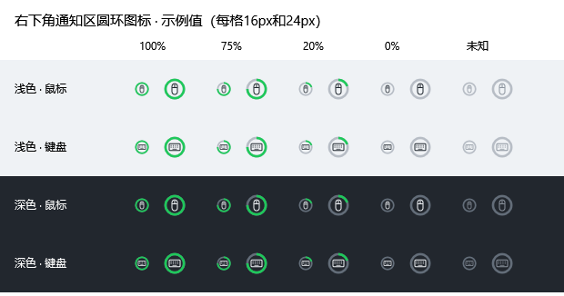

tat

# 无线外设电量 · PeripheralBattery

**简体中文** | [English](README.en.md)

**v1.0.0 · 首次公开发布**

为 Windows 10/11 x64 提供的 2.4G 无线外设电量小工具，当前适配 **迈从 K7 Ultra 鼠标**和 **ROG 游侠 RX TKL 无线键盘**。右下角通知区域分别显示绿色圆环电量图标，配有简洁面板和 HID 调试工具。

## 设备与平台

| 设备 / 平台                            | 当前验证情况                                                            |
| -------------------------------------- | ----------------------------------------------------------------------- |
| 迈从 K7 Ultra                          | 2.4G 接收器 `3837:1001`，逻辑型号 `3837:4150`；电量已与官方软件对照 |
| ROG Strix Scope RX TKL Wireless Deluxe | 2.4G 接收器 `0B05:1A07`；HID 读数已验证，官方软件对照待完成           |
| Windows 10 22H2 x64                    | 已实机验证                                                              |
| Windows 11 x64                         | 兼容目标，尚未实机验证                                                  |

首版针对上述两台设备及其已验证接口，不承诺读取其他型号、接收器或固件版本的电量。

## 功能

- **绿色圆环托盘图标**：鼠标、键盘各一个，绿色弧长表示电量，无数字和持续动画，适配浅深色背景。
- **简洁面板**：两张卡片显示大号百分比、进度条、数据来源和成功更新时间，支持拖动标题栏。
- **跨重启保留读数**：成功读取后保存最新快照；断链、超时或重启后继续显示上次电量，并标注“上次读数”。新读数成功后替换，没有任何有效读数时显示“—”。
- **可选刷新策略**：默认每天一次，可自定义间隔，也可选择鼠标恢复活动或查看时刷新。
- **单实例与自启**：支持当前用户登录自启；面板关闭后驻留托盘，通过设置中的“退出程序”彻底退出。
- **完整 HID 调试**：`--debug` 提供接口枚举、Feature Report 转储、Report ID 探测、被动监听、受控试发与手动协议标定。
- **无运行日志文件**：普通模式只保存设置和最新两条电量快照；调试输出仅在内存与控制台中。

### 图标预览

以下为 **16px / 24px 设计示例**，图中的百分比是示例标签，并非实时设备读数。圆环内不显示数字。



## 下载与使用

1. 在本仓库的 **Releases** 下载 `PeripheralBattery-v1.0.0-win-x64.zip`。
2. 解压整个文件夹到固定位置，运行其中的 `PeripheralBattery.exe`。发布包自带 .NET 运行时，无需另装 .NET；不要只复制 EXE。
3. 首次选择刷新方式和是否开机自启，然后保存。自启只驻留托盘，手动启动打开面板。
4. 两个图标位于屏幕最右下角、时钟旁的通知区域。若在“∧”折叠区内，可拖出来常显；折叠状态由 Windows 管理。

GitHub 自动生成的 `Source code (zip)` 是源码，不是可直接运行的发布包。

| 操作                       | 行为                                             |
| -------------------------- | ------------------------------------------------ |
| 左键鼠标 / 键盘托盘图标    | 刷新对应设备                                     |
| 右键任一托盘图标           | 打开或前置唯一面板，并刷新两台设备               |
| 悬停托盘图标               | 查看精确电量、原成功时间及旧读数状态，不触发查询 |
| 拖住面板顶部标题或空白区域 | 移动面板                                         |
| 点击面板外或面板的 ×      | 隐藏面板，继续后台运行                           |
| 设置 → 退出程序           | 移除两个图标，停止查询并结束全部所属进程         |

圆环始终使用绿色，剩余部分为灰色；面板进度条保留低电警示色。读取失败不会把旧的充电标志继续当作当前充电中。

## 刷新与缓存

| 模式            | 规则                                                                         |
| --------------- | ---------------------------------------------------------------------------- |
| 定时刷新        | 默认每天一次；可设为 1 分钟至 365 天。不唤醒电脑，恢复后错过的任务最多补一次 |
| 活动 / 查看刷新 | 没有周期查询。鼠标静置 5 分钟后的首次活动刷新鼠标；键盘在启动和查看时刷新    |

两种模式启动时均尝试读取两台一次，设置保存后立即生效。鼠标“恢复活动”是对硬件唤醒的近似判断，只使用输入来源和时间，不记录轨迹，也不监听键盘按键。

本地数据位于 `%LOCALAPPDATA%\PeripheralBattery\`：

- `settings.json`：刷新设置、自启选择、设备绑定与已确认标定。
- `battery-cache.json`：两台设备各自最新成功电量、来源、绑定与原更新时间。成功时覆盖保存，失败不改写，不积累历史，不自动过期清空。

自启使用当前用户的 `HKCU\Software\Microsoft\Windows\CurrentVersion\Run\PeripheralBattery` 项。移动程序文件夹后，请重新保存自启设置以更新路径。

## 调试与协议标定

```powershell
.\PeripheralBattery.exe --debug
```

若已运行，会在现有进程中打开调试，不重复创建图标。

- 枚举全部已连接 HID 接口及访问错误，读取 Feature Report，按指定范围探测 Report ID。
- 在厂商接口被动监听 Input Report，不发送查询命令。
- 手动试发需解锁当前会话，只用于电量 / 状态查询；已知迈从配置写入会被拒绝，不提供固件更新、配对或重置功能。
- 标定页支持查询模板、响应匹配、XOR、字段偏移与编码、比例换算和充电标记。偏移从原始响应第 0 字节开始，`Target` 为 `0`（鼠标）或 `1`（键盘）。
- 标定必须匹配唯一接口、测试成功，并人工对照官方软件后才能保存。更换绑定后不会沿用其他绑定的缓存。
- 调试操作期间暂停日常查询，避免报文串扰。原始报文不自动落盘。

`--settings` 打开设置，`--exit` 请求现有实例正常退出。

## 从源码构建

需要 Windows 和 **.NET 10 SDK**：

```powershell
dotnet build -c Release
& .\bin\Release\net10.0-windows\PeripheralBattery.exe --self-test | Out-String
.\publish.ps1
```

发布脚本读取项目版本号，执行自动回归与真实通知区注册检查，输出：

```text
dist/PeripheralBattery-v1.0.0-win-x64/
dist/PeripheralBattery-v1.0.0-win-x64.zip
```

如果当前正在运行同一发布目录的程序，请先从设置中退出，再重新打包。业务代码使用 Windows API 和 WPF，不依赖第三方 HID / UI NuGet 包；发布包包含 .NET 运行时及其许可文件。

其他开发验证入口见 [验证说明](docs/VALIDATION.md)。

## 已知限制与项目文档

Windows 11、其他固件、充电切换、8K 持续移动、高 DPI / 多显示器等场景仍需进一步实机验证。接口被官方软件占用、设备休眠或未返回有效状态时，显示上次读数及失败原因。

- [首次发布说明](docs/RELEASE-v1.0.0.md)
- [更新记录](CHANGELOG.md)
- [验证结果与复验步骤](docs/VALIDATION.md)
- [HID 协议说明](docs/PROTOCOL.md)
- [参考项目与许可证](docs/THIRD-PARTY.md)
- [上传 GitHub 与发布 Release](docs/PUBLISHING.md)
